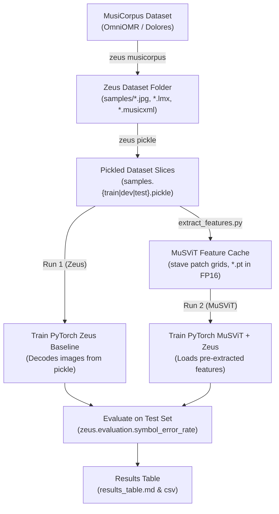

# MuSViT vs. Zeus Benchmark Comparison

This module provides a reproducible, controlled experiment comparing:
- **Run 1 (Zeus Baseline):** CNN-BiLSTM Encoder + Zeus Bahdanau Attention LSTM Decoder (trained from scratch).
- **Run 2 (MuSViT + Zeus):** Pre-trained MuSViT Vision Transformer Feature Extractor + Zeus Bahdanau Attention LSTM Decoder.

Both runs share the **exact same decoder architecture, random seed, training/validation/test splits, learning rate schedule, optimizer, and evaluation metrics**.

---

## 1. Unified Zeus Workflow

The workflow strictly follows the reference Zeus repository implementation:



---

## 2. Dataset Preparation: Convert & Pickle

The dataset preparation converts MusiCorpus datasets (like OmniOMR and Dolores) into Zeus format and bundles them into fast binary `.pickle` files.

Both steps run the embedded Zeus modules (`zeus/`) through `python -m musvit_zeus_comparison.zeus`, so the original Zeus package is not needed.
They need the `linearized-musicxml` package from `requirements.txt`. Run them from the repository root.

### Understanding `splits.json` & Split Isolation
In MusiCorpus datasets, train/val/test splits are defined **at the piece/page level** in a `splits.json` file in the dataset root:
```json
{
  "train": ["piece_id_1", "piece_id_2", ...],
  "dev": ["piece_id_3", ...],
  "test": ["piece_id_4", ...]
}
```
*(Note: Zeus accepts `"dev"`, `"val"`, or `"validation"`).*

### Step 1: Convert MusiCorpus to Zeus Format
Run the `musicorpus` command for each dataset. This applies invisible clef/key normalization and creates a `samples.<split>.txt` for each split in `splits.json` (plus `samples.all.txt`):

```bash
# Convert OmniOMR
python -m musvit_zeus_comparison.zeus musicorpus \
    --input datasets/UFAL.OmniOMR \
    --output datasets/omniomr \
    --take-staves

# Convert Dolores
python -m musvit_zeus_comparison.zeus musicorpus \
    --input datasets/CVC.Dolores \
    --output datasets/dolores \
    --take-staves
```

The split files are named after the keys of `splits.json`; OmniOMR and Dolores call the dev split `validation`, giving `samples.validation.txt`.
Staves whose MusicXML cannot be converted to LMX are logged and skipped (e.g. about 3% of the OmniOMR staves on a 6-page test, due to invisible mid-staff clefs).
The raw MusiCorpus folders can stay in `datasets/`: only folders containing pickled splits are treated as datasets by the training and extraction scripts.

### Step 2: Pickle the Slices
Bundle each split's loose images and LMX files into single `.pickle` files, written next to the `.txt` files:

```bash
# Pickle OmniOMR
python -m musvit_zeus_comparison.zeus pickle \
    datasets/omniomr/samples.train.txt \
    datasets/omniomr/samples.validation.txt \
    datasets/omniomr/samples.test.txt

# Pickle Dolores
python -m musvit_zeus_comparison.zeus pickle \
    datasets/dolores/samples.train.txt \
    datasets/dolores/samples.validation.txt \
    datasets/dolores/samples.test.txt
```

### How Splits Work With Multiple Datasets
All datasets live as subfolders of one directory (default `datasets/`), e.g. `datasets/omniomr/` and `datasets/dolores/`, each with its own pickled splits.
- **Predefined splits only:** every split is read from the dataset's own `samples.{train,dev,test}.pickle`; nothing is re-split randomly. Because splits are assigned at the page/piece level, staves from the same page never cross splits.
- **Free selection per split:** training, validation and test can each combine any datasets, and they may differ (e.g. train on OmniOMR + Dolores, validate on OmniOMR, test on both).
- **Unified Token Vocabulary:** Built from the combined training split, ensuring all grammar tokens of the training datasets are indexed.

---

## 3. Feature Pre-Extraction for MuSViT (Run 2)

Extracts visual features from the pickled stave images with pre-trained MuSViT, preparing each stave as the MuSViT documentation prescribes:
1. The stave image is resized to **1024 x 64** (W x H), ignoring its aspect ratio.
2. It is pasted at the top of a white **1024 x 1024** canvas, the input size MuSViT was pre-trained on (no normalization).
3. Only the patch rows covering the stave are kept: with 16 px patches, a 64 px stave covers the top **4 of the 64 patch rows**, giving a `(4, 64, 768)` grid per stave. The rows of the white padding are cut away.

```bash
# All splits of all datasets in datasets/:
python -m musvit_zeus_comparison.extract_features \
    --dataset-dir datasets \
    --output-dir feature_cache \
    --stave-height 64 \
    --precision float16 \
    --batch-size 8 \
    --num-workers 4 \
    --device cuda

# Only some datasets (names of subfolders of --dataset-dir, dataset folders, or .pickle files):
python -m musvit_zeus_comparison.extract_features --datasets omniomr dolores
```

`--stave-height` sets the height staves are resized to, as a multiple of 16 (the patch size); the number of kept patch rows is `height / 16`.
64 follows the MuSViT documentation. 96 is closer to the median aspect ratio of OmniOMR staves (about 10:1, whereas 1024 x 64 is 16:1), at 1.5x the cache size.
The compute per stave is the same for every height, since MuSViT always processes the whole 1024 x 1024 canvas.

Speed: `--num-workers` processes decode and resize the images ahead of the GPU, and only the stave band is sent to the GPU, where the white canvas is added.
`--tf32` runs the matrix multiplications on the TF32 tensor cores of Ampere and newer GPUs (A16, A4000, L4, ...). It is several times faster but slightly less precise (a 10-bit mantissa, like the FP16 storage), so features extracted with and without it differ slightly. Use one setting for a whole cache.

Features are stored per dataset and setting as `feature_cache/<dataset>/stave<height>_<precision>/<sample_name>.pt`, since sample names are only unique within a dataset; several heights can be cached side by side.
In FP16, a stave takes `height / 16 x 64 x 768 x 2` bytes, i.e. ~393 KB at height 64 (~3.9 GB for 10,000 staves).
Extraction resumes after an interruption and skips already-extracted samples.
*(Caches written by earlier versions, with square-resized staves and vertical pooling, are not used any more and need to be re-extracted.)*

The MuSViT model is gated on Hugging Face: accept its terms on the model page and provide a token via `HF_TOKEN` or `--token`.

---

## 4. Training

Both models train on the exact same pickled slices, using the same hyperparameters matching Zeus (`--learning-rate 1e-3`, `--lr-decay cos`, `--optimizer adam`, `--batch-size 32`):

### Selecting Datasets

| Flag | Meaning |
| :--- | :--- |
| `--dataset-dir DIR` | Directory with the datasets as subfolders (default: `datasets`). |
| `--datasets A B ...` | Datasets used for all splits unless overridden (default: all datasets in `--dataset-dir`). |
| `--train A B ...` | Datasets whose `train` split is used for training (default: `--datasets`). |
| `--dev A B ...` | Datasets whose `dev` split is used for validation and checkpoint selection (default: `--datasets`, or the `--train` datasets if `--datasets` is not given). |
| `--test A B ...` | Datasets whose `test` split is used for testing (default: `--datasets`, or the `--train` datasets if `--datasets` is not given); `--test` without values skips testing. |

Each dataset is given as the name of a subfolder of `--dataset-dir`, a path to a dataset folder, or a path to a `.pickle` file.
For the dev split, `samples.val.pickle` and `samples.validation.pickle` are accepted as well.

```bash
# Everything in datasets/, for all splits:
python -m musvit_zeus_comparison.train --model zeus

# Train on OmniOMR + Dolores, validate on OmniOMR, test on both:
python -m musvit_zeus_comparison.train --model zeus \
    --train omniomr dolores \
    --dev omniomr \
    --test omniomr dolores
```

So `--train omniomr` alone trains, validates and tests on OmniOMR only.
When several test datasets are selected, the test SER is reported for their combination and for each dataset separately.

### Option A: Parallel SLURM Training on Cluster (Recommended)
Submit both jobs to run concurrently on separate GPUs.
*(The `run_zeus.slurm` / `run_musvit.slurm` job scripts are not part of this repository; they need to pass the dataset flags above.)*

```bash
# Submit Run 1: Zeus Baseline
sbatch run_zeus.slurm

# Submit Run 2: MuSViT + Zeus
sbatch run_musvit.slurm
```

Each job outputs its own results (`zeus_results.json` and `musvit_results.json`). `results_table.md` and `results_table.csv` hold only the runs of the job that wrote them, so jobs sharing an `--output-dir` overwrite each other's tables.

To monitor progress:
```bash
tail -f logs/slurm-zeus-baseline-*.out
tail -f logs/slurm-musvit-zeus-*.out
```

### Option B: Interactive CLI Execution

#### Run 1: Zeus Baseline
```bash
python -m musvit_zeus_comparison.train \
    --model zeus \
    --datasets omniomr \
    --epochs 200 \
    --batch-size 32 \
    --learning-rate 1e-3 \
    --lr-decay cos \
    --evaluation-each 10 \
    --output-dir experiment_results \
    --device cuda
```

#### Run 2: MuSViT + Zeus
```bash
python -m musvit_zeus_comparison.train \
    --model musvit \
    --datasets omniomr \
    --feature-cache-dir feature_cache \
    --feature-stave-height 64 \
    --feature-layout columns \
    --feature-precision float16 \
    --epochs 200 \
    --batch-size 32 \
    --learning-rate 1e-3 \
    --lr-decay cos \
    --evaluation-each 10 \
    --output-dir experiment_results \
    --device cuda
```

Before training starts, it is checked that MuSViT features of all selected samples have been extracted with the given `--feature-stave-height` and `--feature-precision`.

`--feature-layout` decides how the `(rows, 64, 768)` patch grid of a stave becomes the encoder's input sequence:
- `columns` (default): one timestep per patch column, with the rows of that column concatenated, i.e. `(64, rows x 768)`. This keeps the vertical position (pitch) of every patch, like the Zeus encoder flattening height x channels per column.
- `raster`: the row-major patch sequence of the MuSViT documentation (`flatten(1, 2)`), i.e. `(rows x 64, 768)`.

#### Run 3: End-to-End MuSViT + Zeus (frozen, fully fine-tuned or LoRA-tuned backbone)
`--model musvit_e2e` puts the MuSViT backbone inside the model, with the Run 2 adapter and the Zeus decoder on top. It reads the stave images instead of cached features, so no extraction is needed, and the backbone can be fine-tuned. Image augmentation can later go in the dataset as well.

```bash
# Frozen for 100 epochs, then fine-tuned with a 1e-5 peak learning rate:
python -m musvit_zeus_comparison.train \
    --model musvit_e2e \
    --datasets omniomr \
    --musvit-model PRAIG/musvit-light \
    --musvit-input interpolate \
    --finetune-from 101 \
    --finetune-lr 1e-5 \
    --musvit-bf16 \
    --output-dir experiment_results_e2e
```

| Flag | Meaning |
| :--- | :--- |
| `--musvit-model ID` | Hugging Face ID of the backbone: `PRAIG/musvit` (default), `PRAIG/musvit-light`, or another ViT, loaded as a plain `ViTModel`. |
| `--musvit-input canvas\|interpolate` | `canvas` (default) pastes the stave band on the white 1024x1024 canvas exactly as `extract_features.py` does, so a frozen backbone computes the Run 2 features. `interpolate` feeds the band alone with interpolated position embeddings, which the MuSViT model card recommends for fine-tuning. At height 64 that is 256 patches instead of 4096, so it is far cheaper. |
| `--stave-height`, `--stave-width` | Size the staves are resized to (default 64 x 1024), multiples of 16. The width must be 1024 with `canvas`. With `interpolate`, `--stave-width aspect` keeps each stave's aspect ratio (see below). |
| `--max-stave-width` | Cap of the `aspect` widths (default 2048); longer staves are squashed. |
| `--feature-layout` | Same as in Run 2. |
| `--finetune-from EPOCH` | The backbone trains from this epoch on and stays frozen before it; `1` fine-tunes from the start. Default: frozen throughout. |
| `--finetune-method full\|lora` | `full` (default) trains all backbone weights. `lora` trains LoRA adapters on the attention query/key/value projections and keeps the pre-trained weights frozen, as the [MuSViT repository](https://github.com/OMR-PRAIG-UA-ES/MuSViT/tree/main/experiments/staff_level_omr) fine-tunes for staff-level OMR. Needs `peft`. |
| `--finetune-lr LR` | Peak learning rate of the backbone (default `1e-5` with `full`, `3e-4` with `lora`, the MuSViT repository's). It follows the `--lr-decay` schedule, scaled, and is 0 while frozen. |
| `--lora-rank R`, `--lora-alpha A`, `--lora-dropout P` | LoRA settings (defaults `8`, `16`, `0.1`, the MuSViT repository's). The adapters are rank-stabilized, i.e. scaled by `A / sqrt(R)`. |
| `--finetune-warmup-epochs N` | After unfreezing, the backbone learning rate rises linearly from 0 over N epochs (default 5; fractions allowed; `0` disables). It is updated at every step. |
| `--musvit-bf16` | Runs the backbone in bfloat16 autocast: much faster and lighter on Ampere+ GPUs. |
| `--grad-checkpointing` | Recomputes backbone activations in the backward pass, saving GPU memory while fine-tuning. |
| `--init-from CKPT` | Starts a new run (epoch 1, fresh optimizer) from a checkpoint's weights. A `musvit` (Run 2) checkpoint with matching feature settings initializes the adapter and decoder; the backbone keeps its pre-trained weights. |
| `--hf-token` | Token for the gated MuSViT models (default: `HF_TOKEN`). |

A fixed width stretches short staves and squashes long ones, so the horizontal scale differs from stave to stave. `--stave-width aspect` (with `interpolate`) instead resizes each stave to `--stave-height` with its aspect ratio kept, rounds the width to a multiple of 16 and caps it at `--max-stave-width`, like the Zeus baseline does at height 96. A batch is padded with white to its widest stave, and the padding is masked:
- **Position embeddings:** Hugging Face would stretch the pre-trained 64 x 64 position grid over the padded batch width, so a stave's embeddings would depend on its batch. Instead, the grid is stretched over `--max-stave-width` pixels and cut at the input's width, so a patch column always gets the same embedding. Vertically, the grid is still stretched over the stave height. With a fixed `--stave-width`, the grid is stretched over that width, which is exactly Hugging Face's interpolation.
- **Attention:** the padding patches are masked out of the backbone's attention (this needs a transformers version whose `ViTModel` takes an `attention_mask`, e.g. 5.x), and out of the adapter BiLSTM and the decoder's attention. A stave's features are therefore the same in any batch.
- **Size:** at height 96, MuSViT's 1024 x 1024 pre-training pages put staves at roughly 85-100 px high, so 96 is about the scale MuSViT has seen (64 is noticeably smaller). A 96 x 2048 stave has 768 patches, against 256 for 64 x 1024; add `--grad-checkpointing` if fine-tuning runs out of GPU memory.

Ways to start fine-tuning:
- **From scratch, fine-tuning from epoch N:** `--finetune-from N`.
- **Resuming a run with fine-tuning on:** e.g. a frozen run stopped at epoch 100, continued with `--resume auto --finetune-from 101`. This gives the same result as an uninterrupted run with `--finetune-from 101`. A warning is printed if a run that was already fine-tuned is resumed without `--finetune-from`.
- **From a trained Run 2 model:** `--init-from experiment_results/musvit_best.pt --finetune-from 1`, usually with a lower `--learning-rate` for the adapter and decoder.

With `--finetune-method lora`, the adapters are in the model from the start but add nothing until `--finetune-from` (they start at zero), so the frozen phase, the warmup and resuming work as with full fine-tuning. A run must be resumed with the method it started with. To LoRA-tune a model trained without LoRA, start a new run with `--init-from CKPT --finetune-method lora --finetune-from 1`: the checkpoint's backbone becomes the frozen base weights.

The backbone has its own optimizer parameter group from the start, so frozen and fine-tuned checkpoints share one layout. The checkpoints include the backbone, which makes them much larger (~350 MB for MuSViT, about 3x that with the Adam state once fine-tuned). Results go to `musvit_e2e_results.json` and the results table. Use a separate `--output-dir` for each backbone or setting, since they share the `musvit_e2e_*` file names.

`run_musvit_e2e.slurm` in the repository root trains Run 3 from scratch for 1000 epochs. It uses `interpolate` input with aspect-preserving 96 px high staves, Zeus augmentation and bf16, and fine-tunes from epoch 101. Each job resumes from the latest checkpoint, so the run is submitted as a chain of jobs (see the script's header).

### Image Augmentation
`--augment` augments the training images of `zeus` and `musvit_e2e` the way the TensorFlow Zeus does, with the same syntax:

```bash
--augment "h:8,rotate:1,v:4,de,en3:0.2,n:0.01,c:-1:1,b:-0.5:0.2"
```

It is a comma-separated pipeline of filters, each applied with a 50:50 chance: horizontal shift, rotation, vertical shift, dilatation/erosion, boundary noise, global noise, contrast and brightness (see `augmentation.py` and Zeus's `docs/augmentations.md`). The default is no augmentation, so existing runs stay unchanged.
- As in Zeus, augmentation is the last step before the model, so the pixel amounts refer to the model's input: the 96 px high Zeus image, or the stave band of `musvit_e2e` (e.g. 64 x 1024).
- On the stave bands, the horizontal shift moves the content by the same amount, but pads or crops the right side so that the width stays (a multiple of the patch size). Zeus instead lets the width change.
- Each training sample gets its own seed from the batch sampler, whose state is saved in checkpoints. So augmented training resumes exactly as well, for any `--num-workers`.
- Pre-extracted features (`musvit`) cannot be augmented.

### Training Speed
The following are on by default and do not change what is computed (beyond floating-point rounding):
- **Length-bucketed batches:** the decoder runs for the longest transcription of a batch, so training batches are formed from pools of `--length-bucket-batches` (default 50) batches sorted by transcription length, and the batches are then shuffled. On the OmniOMR + Dolores length distribution, this cuts the decoder steps spent on padding from about 50% to a few percent. `--length-bucket-batches 1` gives plain random batches. Evaluation batches are sorted by length, and predictions are put back in dataset order.
- **TF32 matrix multiplications** on Ampere and newer GPUs (A16, A4000, L4, ...) for the decoder LSTM cell, the attention and the projections. PyTorch already uses TF32 for convolutions and cuDNN LSTMs by default. `--no-tf32` computes them in full FP32.
- **Fused Adam / AdamW** on CUDA, **pinned memory** with asynchronous copies to the GPU, and **persistent DataLoader workers**, which are not re-forked for every epoch.
- **No waiting for the GPU** after every batch: losses are accumulated on the GPU, sequence lengths stay on the CPU for packing, and greedy decoding checks for finished sequences only every 8 steps.

`--preload-features` reads all MuSViT feature files into RAM once (~0.4 MB per stave at height 64, ~4.6 GB for OmniOMR + Dolores) instead of from disk in every epoch, which helps on slow (e.g. network) filesystems.
The MuSViT-only run drops the stave images after loading, since it only uses the extracted features.

### Checkpoints and Resuming
- `<model>_best.pt` is the checkpoint with the lowest validation SER (evaluated every `--evaluation-each` epochs). With `--evaluation-each 0`, the lowest validation loss is used instead.
- `<model>_latest.pt` is written after every epoch. Both hold the model, optimizer and RNG state, the vocabulary and the training history.
- `--resume auto` continues from `<model>_latest.pt` exactly where training stopped (the same losses as an uninterrupted run, for any `--num-workers`); `--resume <path.pt>` continues from a given checkpoint (single `--model` only). `--epochs` may be raised when resuming; the cosine schedule follows the new value.
- `--eval-only` evaluates `<model>_best.pt` (or the checkpoint given by `--resume`) without training.
- `--max-gen-length` defaults to 1.2x the longest training transcription; a warning is printed if dev/test transcriptions are longer.

---

## 5. Evaluation & Results

Evaluation uses `zeus.evaluation.symbol_error_rate` directly:
1. **Validation SER:** Evaluated every `--evaluation-each` epochs during training; it selects the best checkpoint.
2. **Final metrics:** Validation loss, token accuracy, validation SER and test SER are all reported for the selected checkpoint.

Results are printed to stdout and saved in `experiment_results/`:
- `results_table.md` (Markdown format)
- `results_table.csv` (Spreadsheet format)
- `zeus_results.json`, `musvit_results.json` (per run, including the dataset selection)

Example output (illustrative numbers):

| Model Run | Encoder | Enc Params | Dec Params | Total Params | Best Epoch | Val Loss | Token Acc (%) | Val SER (%) | Test SER (%) | Train Time (s) |
| :--- | :--- | :--- | :--- | :--- | :--- | :--- | :--- | :--- | :--- | :--- |
| **Zeus Baseline (Run 1)** | CNN-BiLSTM | 851,200 | 1,185,420 | 2,036,620 | 180 | 0.8241 | 82.15% | 18.42% | 19.10% | 145.2s |
| **MuSViT + Zeus (Run 2)** | MuSViT + Adapter | 394,496 | 1,185,420 | 1,579,916 | 150 | 0.5120 | 89.64% | 11.20% | 11.85% | 42.1s |

With several test datasets, a `Test SER <dataset> (%)` column is added for each.
Encoder parameters of the MuSViT run exclude the frozen MuSViT backbone, and its training time excludes feature extraction.

### Predictions as MusiCorpus Datasets (OMR-NED)
The final evaluation also writes the selected checkpoint's predictions as a predicted MusiCorpus dataset per source dataset (see `predictions.py`), for MusicXML-level evaluation with [omr-benchmark](../omr-benchmark/README.md):

```
<output-dir>/<model>_predictions/<dataset>/
  prediction.json                               # per written split: model, epoch, SER, counts, MusicXML failures
  <page>/Staves/<n>/transcription.lmx           # predicted LMX
  <page>/Staves/<n>/transcription.musicxml      # decoded from it with Zeus's lmx_to_musicxml
```

| Flag | Meaning |
| :--- | :--- |
| `--save-predictions dev test` | Splits whose predictions are written (default: `test`). Without values, none. Writing `dev` decodes the validation split once more. |
| `--predictions-dir DIR` | Where to write them (default: `<output-dir>/<model>_predictions`). |

The splits of a dataset share its folder, since they hold different pages. Predicted LMX that the decoder cannot turn into MusicXML (e.g. tokens before the first `measure`) keeps its `.lmx` but gets no `.musicxml`, so omr-benchmark scores the staff as missing (OMR-NED 1).
For an already trained model, `--eval-only` with the run's arguments writes the predictions of its best checkpoint.

**Evaluate against the normalized gold.** The conversion to Zeus replaces invisible header clefs with a G clef and invisible key signatures with C major, so the models learn to transcribe e.g. a staff with an invisible bass clef as if it were in treble clef. Against the original MusiCorpus gold, every pitch of such a staff is wrong: on Dolores.Small, the gold LMX itself, written as a prediction, scores 0.43 OMR-NED against the original gold and 0.004 against the normalized one (the remaining edits are endings and barline styles, which LMX does not encode). The normalized gold is the MusicXML the conversion wrote beside each LMX; export it as a MusiCorpus dataset with:

```bash
python -m musvit_zeus_comparison.predictions normalized-gold datasets/omniomr datasets/gold/omniomr

omr-benchmark evaluate datasets/gold/omniomr \
    experiment_results/zeus_predictions/omniomr experiment_results_e2e/musvit_e2e_predictions/omniomr \
    --split test -b staff-omr-ned -o benchmark_results/omniomr-test
```

It reads the loose `samples/` files of the Zeus dataset folder, not the pickles, and its `splits.json` holds the pages of the `samples.<split>.txt` files. Staves the conversion skipped are not in it and are not scored.

---

## 6. Serving a Trained Model in Musibot

`musibot_model.py` wraps a trained `zeus` or `musvit_e2e` model as a [Musibot](../musibot/docs/adding-models.md) *Model*: a process that a Musibot Worker Head starts and drives over the worker IPC. It reads one staff crop per execution and writes its transcription beside it, with the same signature as the deployed Zeus:
`Staves/{s}/image.jpg` -> `Staves/{s}/transcription.musicxml` and `Staves/{s}/transcription.lmx`.

**1. Export a checkpoint as a snapshot folder** (`model.json`, `vocab.json`, `weights.pt`):

```bash
python -m musvit_zeus_comparison.musibot_model export     experiment_results_e2e/musvit_e2e_best.pt snapshots/musvit-e2e-2026-10-15.model
```

- The snapshot is self-contained. `weights.pt` holds all weights, including the fine-tuned MuSViT backbone, and the backbone is built from the ViT configuration in `model.json`, so serving downloads nothing from Hugging Face.
- `--name` and `--version` set what is announced to Musibot (default `zeus-baseline` / `musvit-e2e`, and the checkpoint's time and epoch, e.g. `2026-10-15-153411-e180`). Pipelines pin the version, so give a re-exported model a new one.
- Checkpoints store their model configuration (`config`) since this was added. Older checkpoints need the `train.py` arguments that change inference: `--max-gen-length` (printed by `train.py` as *Max generation length*) is required, and `--image-height`, `--max-image-width`, `--musvit-model`, `--musvit-input`, `--stave-height`, `--stave-width`, `--max-stave-width`, `--feature-layout` default to those of `train.py`. For `musvit_e2e`, the ViT configuration of `--musvit-model` is downloaded (not its weights), which needs the Hugging Face token. Settings that change the shapes of weights are checked when the weights are loaded, but the preprocessing and the generation length are not, so pass them as the run was trained, e.g. `--musvit-input interpolate --stave-height 96 --stave-width aspect` for `run_musvit_e2e.slurm`.

**2. Run it under a Worker Head** (Linux or WSL only, since the IPC passes file descriptors):

```bash
musibot-worker-head --model-command     "/path/to/venv/bin/python -m musvit_zeus_comparison.musibot_model serve --model-snapshot /path/to/snapshots/musvit-e2e-2026-10-15.model"
```

The command must run from a directory containing `musvit_zeus_comparison` (or have it on `PYTHONPATH`). `serve` takes `--device` (default: CUDA if available), `--bf16` for the backbone, and `--batch-size` for batched executions. The model is never started by hand: it needs the descriptors and the pages directory that the Worker Head passes in the environment. Its stdout and stderr become the log shown in the Musibot web UI.

Resuming a `musvit_e2e` run from a checkpoint with a stored configuration no longer downloads the pre-trained MuSViT weights, since the checkpoint holds all backbone weights, frozen or fine-tuned. New runs, and `--init-from` a Run 2 checkpoint, still start from the pre-trained weights.

---

## 7. Directory Layout

```
musvit_zeus_comparison/
├── __init__.py          # Package exports
├── models.py            # ZeusEncoder, MusvitEncoder, MusvitBackbone, MusvitE2EEncoder, ZeusDecoder, CombinedOMRModel
├── augmentation.py      # Zeus training image augmentation (--augment), ported from TensorFlow
├── dataset.py           # In-memory ZeusDatasetSample loader, TokenVocabulary, StaveCollate
├── extract_features.py  # MuSViT feature extractor (padded 1024x1024 canvas, stave patch rows, FP16)
├── train.py             # Main trainer & evaluator with automated table generation
├── predictions.py       # Predictions as predicted MusiCorpus datasets, and the normalized gold to score them against
├── musibot_model.py     # Musibot wrapper: checkpoint -> snapshot export, and the worker IPC model process
├── zeus/                # Embedded Zeus core modules (data, evaluation, musicorpus, musicxml) and
│                        #   their CLI: python -m musvit_zeus_comparison.zeus musicorpus|pickle
└── README.md            # Documentation
```
